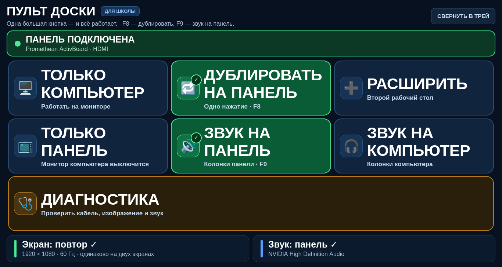

# Пульт доски

Windows-приложение для школы: компьютер преподавателя подключён к интерактивной панели, а учитель одним нажатием выбирает, куда идёт изображение и звук. Без Win+P, без «Панели управления звуком» и без прав администратора.

Рабочее название: **«Пульт доски»**. Техническое имя: `PanelRemote`.



*Макет 1:1; реальное WPF-окно использует ту же сетку и цвета.*

> **Статус:** код и single-file EXE собраны, ABI-структуры и установка проверены. На реальной Windows с интерактивной панелью приложение ещё не прогонялось — см. [docs/TEST-STATUS.md](docs/TEST-STATUS.md) и [docs/TEST-CHECKLIST.md](docs/TEST-CHECKLIST.md).

## Что умеет

- **Экран.** Находит подключённую панель по HDMI / DisplayPort / USB-C и предлагает четыре понятных режима:
  - «Только компьютер»;
  - «Дублировать на панель» (главная кнопка);
  - «Расширить»;
  - «Только панель».
- **Звук.** Находит HDMI/DisplayPort-аудио панели и колонки компьютера. Две кнопки меняют устройство воспроизведения по умолчанию через Windows Core Audio.
- **Статус всегда на экране.** Крупно показывает, какой режим включён, какое разрешение и куда идёт звук. Реагирует на подключение и отключение кабеля.
- **Самопочинка.** «Диагностика» проверяет кабель, заново применяет режим, повторяет HDMI handshake, отправляет тестовый звук и крупно объясняет, что не так.
- **Помнит выбор.** После переподключения панели восстанавливает последний режим экрана и звука.
- **Тихая установка.** Один EXE. При первом запуске сам копируется в профиль пользователя, добавляет автозапуск и ярлыки. UAC не появляется.
- **Трей и горячие клавиши.** Окно сворачивается в трей; F8 — дублировать, F9 — звук на панель.

## Установка

Требования: Windows 10 или Windows 11, x64. .NET устанавливать не нужно — EXE самодостаточный.

1. Скопируйте `PanelRemote.exe` на компьютер.
2. Дважды щёлкните по нему.

Этого достаточно:

- программа тихо копируется в `%LOCALAPPDATA%\Programs\PanelRemote`;
- в `HKCU\Software\Microsoft\Windows\CurrentVersion\Run` добавляется автозапуск;
- на рабочем столе и в меню «Пуск» появляется ярлык **«Пульт доски»**;
- при следующих входах в Windows приложение стартует в трее.

Права администратора не нужны.

### Тихая установка без запуска

```bat
PanelRemote.exe --install --silent
```

### Портативный режим

```bat
PanelRemote.exe --portable
```

Ничего не копирует, не прописывает в автозапуск и не создаёт ярлыки. Удобно для проверки с флешки.

### Удаление

```bat
PanelRemote.exe --uninstall
```

Удаляются автозапуск и ярлыки. Настройки и журналы в `%LOCALAPPDATA%\PanelRemote` остаются — их можно удалить вручную.

## Как пользоваться

На первом уровне нет меню и настроек — только семь больших кнопок и статус.

| Кнопка | Что делает |
|---|---|
| 🖥️ ТОЛЬКО КОМПЬЮТЕР | оставляет изображение на мониторе/экране ноутбука, панель выключает |
| 🔁 ДУБЛИРОВАТЬ НА ПАНЕЛЬ | показывает то же изображение на компьютере и панели |
| ➕ РАСШИРИТЬ | делает панель вторым рабочим столом |
| 📺 ТОЛЬКО ПАНЕЛЬ | выводит изображение только на панель |
| 🔊 ЗВУК НА ПАНЕЛЬ | переключает звук на HDMI-аудио панели |
| 🎧 ЗВУК НА КОМПЬЮТЕР | возвращает звук на колонки компьютера |
| 🩺 ДИАГНОСТИКА | проверяет подключение, повторно применяет режим и объясняет проблему |

Если панель не подключена, это не ошибка: окно крупно пишет «Панель не подключена — воткните кабель HDMI», а после подключения само применяет сохранённые настройки.

## Где журналы

```
%LOCALAPPDATA%\PanelRemote\logs\panel-ГГГГММДД.log
```

В журнал пишутся:

- найденные дисплеи, их имена, разъёмы, разрешение и активность;
- выбранные и применённые режимы;
- найденные аудиоустройства и смена устройства по умолчанию;
- ошибки Windows API и исключения;
- события подключения/отключения панели, выхода из сна.

Журнал открывается из окна диагностики кнопкой «Открыть журнал». Это позволяет разобрать «чёрный экран» по логам, не приезжая в класс.

## Устройство проекта

```
src/PanelRemote/
  Interop/                 P/Invoke и COM: CCD, Core Audio, user32
  Services/
    DisplayService.cs      четыре режима, детект панели, общий режим клона
    AudioService.cs        MMDevice, IPolicyConfig, тестовый звук
    AppController.cs       сценарии, горячее подключение, диагностика
    InstallService.cs      установка в профиль, HKCU Run, ярлыки
    SettingsStore.cs       JSON в %LOCALAPPDATA%
    AppLog.cs              журнал
  Controls/ActionTile.xaml огромная кнопка
  ViewModels/              состояние экрана и команды
  MainWindow.xaml          7 кнопок, статус, диагностика, трей
  Assets/app.ico

tests/InteropLayoutChecks/ ABI-регрессия native-структур и флагов CCD
scripts/                   build-release.sh, generate-icon.py
docs/                      техническое описание, handoff, тест-чек-лист
preview/                   макеты UI (не скриншоты WPF)
artifacts/                 локальная сборка EXE/ZIP, в git не попадает
```

Стек: **C# + WPF, .NET 8, win-x64, self-contained single-file**. WPF выбран потому, что он входит в Windows desktop stack, даёт крупный контрастный интерфейс и трей без сторонних библиотек, а все нужные Win32-вызовы доступны через P/Invoke/COM. Подробности — в [docs/TECHNICAL.md](docs/TECHNICAL.md).

Документы для передачи:
- [AGENTS.md](AGENTS.md) — краткая инструкция следующему агенту;
- [docs/HANDOFF.md](docs/HANDOFF.md) — что делалось, как проверялось и что осталось;
- [docs/TEST-STATUS.md](docs/TEST-STATUS.md) — честная матрица проверок;
- [docs/TEST-CHECKLIST.md](docs/TEST-CHECKLIST.md) — приёмка на панели.

## Сборка

Нужен .NET SDK 8.

На Windows:

```bat
build.cmd
```

или:

```powershell
powershell -ExecutionPolicy Bypass -File .\build.ps1
```

Результат:

```
artifacts\PanelRemote\PanelRemote.exe
artifacts\PanelRemote-win-x64.zip
```

`artifacts/` намеренно в `.gitignore`: в репозиторий попадает исходный код, а не 64-мегабайтный бинарник. Для GitHub Release/архива используйте файл из `artifacts/`.

Проверка размеров нативных структур и флагов CCD (не требует Windows):

```bash
dotnet run --project tests/InteropLayoutChecks/InteropLayoutChecks.csproj
```

На Linux/macOS с .NET SDK 8 (кросс-сборка, без запуска WPF):

```bash
./scripts/build-release.sh
```

Скрипт сначала прогоняет ABI-тест, затем собирает `win-x64` single-file и ZIP. В GitHub Actions то же самое проверяется на Windows и Ubuntu — [.github/workflows/build.yml](.github/workflows/build.yml).

## Ограничения, о которых должны знать школа и техподдержка

- **Физически чёрный экран нельзя отличить от исправного HDMI по Windows API.** Если Windows уже считает панель активной, но на панели нет картинки, приложение не может это «увидеть». Поэтому:
  - при переподключении кабеля повтор выполняется принудительно;
  - «Диагностика» всегда заново применяет режим и повторяет HDMI handshake;
  - если не помогло, диагностика просит проверить кнопку источника HDMI на самой панели и кабель.
- **Несколько внешних мониторов.** Панель выбирается по типу разъёма, имени устройства и признаку «не основной экран». Если к компьютеру подключено два одинаковых HDMI-монитора, автоматика может ошибиться — в журнале видны все кандидаты.
- **Звук панели.** Если панель не отдаёт HDMI-аудио и её динамики подключены отдельным USB-кабелем без узнаваемого имени, Windows может не связать это устройство с панелью. Приложение покажет «динамики панели не найдены» и не будет вслепую переключать звук на случайные колонки.
- **Разрешение при дублировании.** Windows сам подбирает режим, поддерживаемый обоими дисплеями; приложение дополнительно проверяет общий режим и пытается выбрать его, если текущий не общий.
- Интерфейс рассчитан на экран от 1366×768 при 100 % масштабе; оптимально — 1920×1080.
- Приложение не устанавливает драйверы и не требует администратора. Если групповая политика запрещает запись в HKCU\\...\\Run, автозапуск не включится, но программа продолжит работать.
- EXE не подписан сертификатом. При первом запуске SmartScreen может показать предупреждение; для массового развёртывания в школе EXE стоит подписать корпоративным сертификатом.

## Проверка на реальной панели

Краткий чек-лист: [docs/TEST-CHECKLIST.md](docs/TEST-CHECKLIST.md). Результаты фиксируются в [docs/TEST-STATUS.md](docs/TEST-STATUS.md).

## Репозиторий

Проект лежит в приватном репозитории: [https://github.com/bat86/panel-remote](https://github.com/bat86/panel-remote) (ветка `main`).

```bash
git clone https://github.com/bat86/panel-remote.git
```

`artifacts/` и локальные журналы в git не входят. Если проект нужно перенести подпапкой в другой приватный репозиторий — скопируйте содержимое этой папки туда и закоммитьте.
